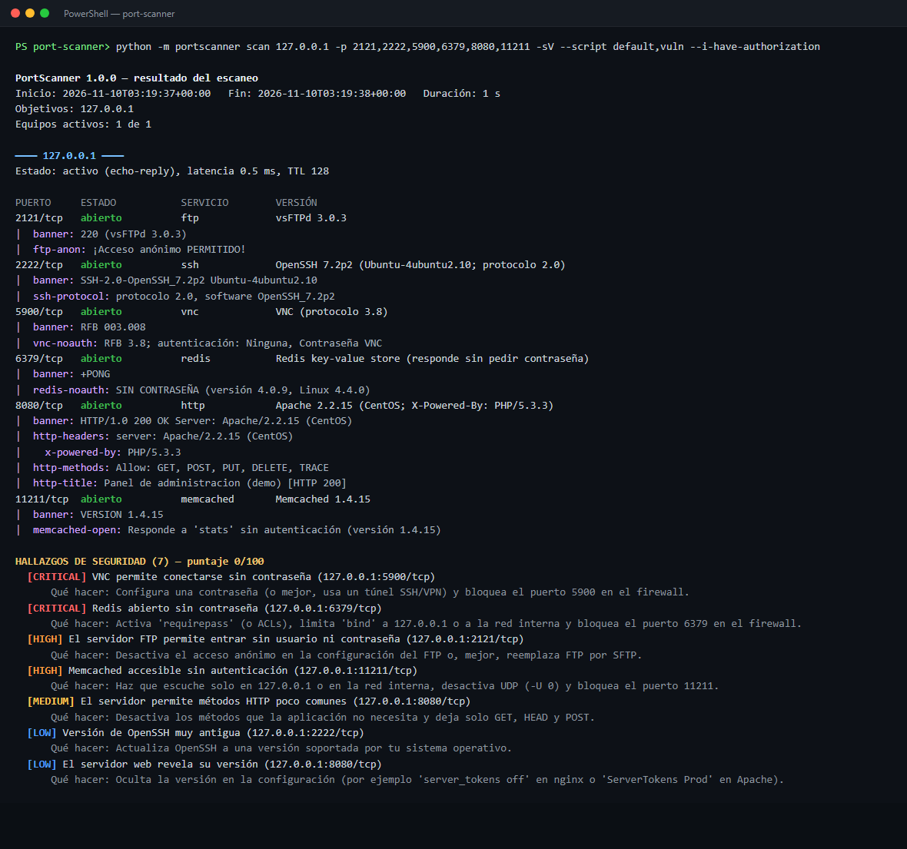
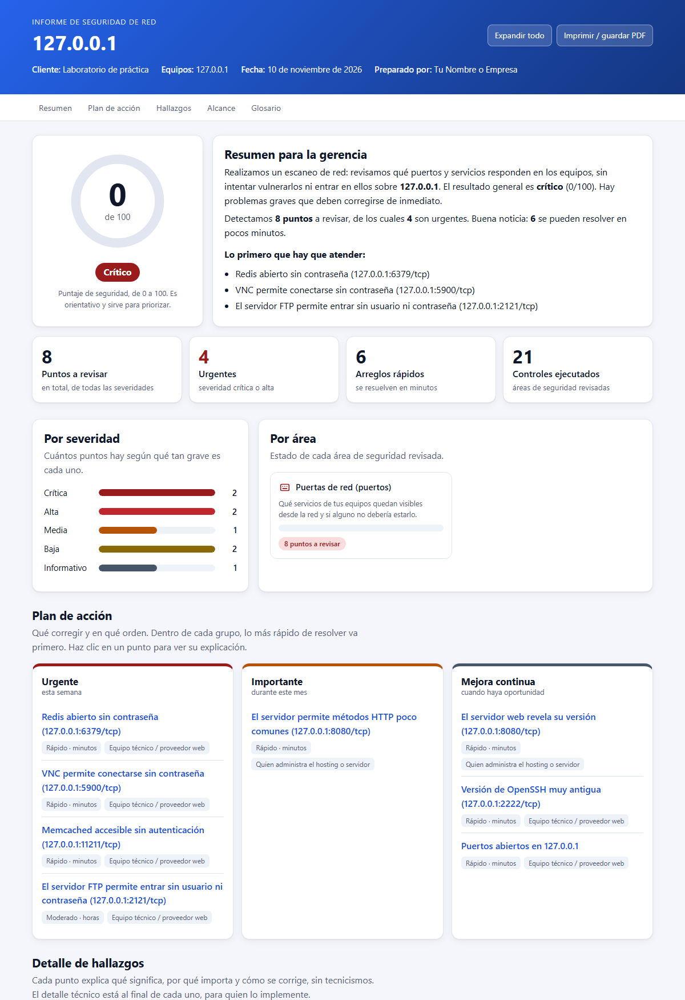

# PortScanner

  

Escáner de puertos **TCP/UDP** en Python puro (sin instalar nada), inspirado en Nmap. Revisa qué "puertas" (puertos) tiene
abiertas un equipo, qué programa atiende cada una y si alguna es un riesgo, y entrega el resultado en texto, JSON, XML,
formato grepable o HTML.

Proyecto personal de aprendizaje en ciberseguridad y redes: sockets, concurrencia con `asyncio`, reconocimiento de
protocolos y diseño seguro de herramientas ofensivas (autorización obligatoria, solo detecta, nunca explota).



> ⚠️ Escanea **solo equipos propios o con autorización escrita**. El programa exige `--i-have-authorization`.
> Escanear equipos ajenos sin permiso puede ser delito.

## Qué puede hacer

| Función | Opción |
|---|---|
| Descubrir qué equipos de una red están encendidos | `-sn`, `-Pn`, `-PE`, `-PS 22,80` |
| Escaneo **TCP** de todos los puertos (1-65535) o los que elijas | `-p-`, `-p 1-1000`, `-p 22,80,443`, `-F`, `--top-ports N` |
| Escaneo **UDP** (DNS, SNMP, NTP...) | `-sU`, `-p T:22,80,U:53,161` |
| Detectar servicios y versiones (SSH, HTTP, MySQL, Redis...) | `-sV`, `--version-intensity 0-9` |
| Adivinar el sistema operativo | `-O` |
| Scripts de comprobación (FTP anónimo, certificado TLS, Redis sin clave...) | `-sC`, `--script vuln` |
| Todo lo anterior + traceroute | `-A`, `--traceroute` |
| Velocidad | `-T0` (lento y discreto) a `-T5` (muy rápido) |
| Muchos equipos | `192.168.1.0/24`, `192.168.1.1-50`, `-iL lista.txt`, `--exclude` |
| Guardar resultados | `--format text/json/xml/grepable/html`, `-oA nombre` |

## Instalación

No necesita librerías. Solo Python 3.10 o superior (probado con 3.14):

```bash
git clone https://github.com/MauExpl01t/port-scanner.git
cd port-scanner
python -m portscanner --version
```

## Uso rápido

```bash
# Los 1000 puertos más comunes de un equipo propio
python -m portscanner scan 192.168.1.10 --i-have-authorization

# TODOS los puertos TCP, con servicios y scripts seguros
python -m portscanner scan 192.168.1.10 -p- -sV -sC --i-have-authorization

# Modo completo (servicios + sistema operativo + scripts + traceroute)
python -m portscanner scan 192.168.1.10 -A --i-have-authorization

# Qué equipos hay encendidos en una red (sin escanear puertos)
python -m portscanner scan 192.168.1.0/24 -sn --i-have-authorization

# Puertos UDP importantes
python -m portscanner scan 192.168.1.10 -sU -p 53,123,161,1900 --i-have-authorization

# Buscar exposición peligrosa (Redis/MongoDB/VNC sin clave, SMBv1...)
python -m portscanner scan 192.168.1.10 -sV --script vuln --i-have-authorization

# Guardar todo (texto, JSON, XML, grepable y HTML) con el mismo nombre base
python -m portscanner scan 192.168.1.10 -A -oA escaneo_equipo --i-have-authorization
```

Para ver todas las opciones: `python -m portscanner scan --help`. Para ver los scripts: `python -m portscanner list-scripts`.

## Laboratorio de práctica (seguro)

[`examples/lab_demo.py`](examples/lab_demo.py) levanta en tu propio equipo (solo `127.0.0.1`) seis servicios **falsos y
"vulnerables"**: FTP anónimo, Redis sin contraseña, VNC sin autenticación, Memcached abierto, un Apache antiguo y un
OpenSSH viejo. Sirve para probar el escáner sin tocar equipos reales (es lo que se ve en la captura de arriba):

```bash
# Terminal 1: levantar el laboratorio (Ctrl+C lo detiene)
python examples/lab_demo.py

# Terminal 2: escanearlo
python -m portscanner scan 127.0.0.1 -p 2121,2222,5900,6379,8080,11211 -sV --script default,vuln --i-have-authorization
```

## Cómo leer el resultado

| Estado | Qué significa |
|---|---|
| **abierto** | Hay un programa escuchando y aceptó la conexión |
| **cerrado** | El equipo está vivo, pero nadie escucha en ese puerto |
| **filtrado** | No hubo respuesta: seguramente un firewall descarta los paquetes |
| **abierto\|filtrado** | (UDP) No respondió; no se puede saber si está abierto o filtrado |

Un `?` junto al servicio (por ejemplo `mysql?`) significa que el nombre se **supuso por el número de puerto** y no se
confirmó. Usa `-sV` para confirmarlo.

Los hallazgos tienen severidad `CRITICAL`, `HIGH`, `MEDIUM`, `LOW` o `INFO` y un puntaje de 0 a 100.
`--fail-on HIGH` hace que el programa termine con código 2 si hay hallazgos de esa severidad o más graves (útil para
automatizaciones).

## Informe para el cliente

El JSON es compatible con [`report-generator`](https://github.com/MauExpl01t/report-generator), que lo convierte en un
informe tipo dashboard (HTML o PDF) con explicaciones en lenguaje simple:

```bash
python -m portscanner scan 192.168.1.10 -A --i-have-authorization --format json -o resultado.json
python -m reportgen resultado.json -o informe.html --pdf informe.pdf --client "Mi Cliente" --author "Mi Empresa"
```



Un resultado de ejemplo está en [`examples/ejemplo_resultado.json`](examples/ejemplo_resultado.json).

## Cómo funciona

- **Escaneo TCP "connect"**: intenta abrir una conexión normal a cada puerto, miles a la vez usando `asyncio`.
  No necesita permisos de administrador. En Windows se desactivan los reintentos automáticos del SYN del sistema
  (igual que Nmap), porque de lo contrario cada puerto cerrado tardaría ~2 segundos en responder "rechazado".
- **Escaneo UDP**: envía un mensaje propio de cada protocolo (una consulta DNS, un paquete NTP, una petición SNMP...).
  Si responde, está abierto; si el equipo contesta "puerto inalcanzable" (ICMP), está cerrado; si no pasa nada,
  `abierto|filtrado`.
- **Descubrimiento de equipos**: ping del sistema + intentos de conexión a puertos comunes + la tabla ARP del sistema.
- **Servicios**: primero *escucha* el saludo del servidor (SSH, FTP, SMTP, MySQL saludan solos); si no hay saludo, prueba
  sondas (petición HTTP, `PING` de Redis, saludo TLS...) y compara con una tabla de firmas.
- **Sistema operativo**: pista del TTL del ping (Windows ≈ 128, Linux ≈ 64), puertos típicos y textos de los servicios.
- **Scripts**: solo *detectan* exposición (no modifican nada, no adivinan contraseñas, no explotan fallos).
- **Resistente a fallos**: un servicio raro, un error de red o un Ctrl+C no pierden el escaneo; se muestran los resultados
  parciales (código de salida 130).

## Scripts incluidos

`banner`, `http-title`, `http-headers`, `http-methods`, `ssl-cert`, `ssl-weak-protocols`, `ssh-protocol`, `ftp-anon`,
`smtp-commands`, `redis-noauth`, `memcached-open`, `mongodb-noauth`, `vnc-noauth`, `smb-v1`, `docker-api-exposed`,
`elasticsearch-open`, `snmp-public`, `dns-recursion`. Categorías: `default` (lo que corre `-sC`), `safe`, `vuln`, `all`.

## Qué demuestra este proyecto

- **Redes y sockets**: TCP connect, UDP con ICMP, resolución DNS propia (cliente DNS mínimo), ARP, TTL y traceroute.
- **Concurrencia**: miles de conexiones simultáneas con `asyncio`, límites por plantilla de velocidad, cancelación limpia.
- **Análisis de protocolos**: reconocimiento de SSH, HTTP/TLS, MySQL, Redis, VNC, SMB, SNMP, MongoDB y más a partir de bytes.
- **Seguridad por diseño**: autorización obligatoria, límites de tamaño de red, sin explotación, informes sin rutas locales.
- **Calidad de software**: más de 120 pruebas automáticas contra servidores falsos en `127.0.0.1`, sin depender de internet.
- **Comunicación**: hallazgos en lenguaje simple con severidad y recomendación, y salida compatible con otras herramientas.

## Límites

- **`-sS` (SYN) es experimental**: necesita `scapy`, Npcap y administrador, y **no está probado**. Si falta algo, el
  programa avisa y usa `-sT` (connect).
- **UDP es lento y menos fiable**: muchos sistemas limitan los avisos ICMP, así que muchos puertos quedan como `abierto|filtrado`.
- **El sistema operativo es una aproximación**, no una huella como la de Nmap.
- **Escanear `127.0.0.1` no dice si el servicio es visible para otros**; por eso en localhost no se generan hallazgos de
  riesgo de puertos. Escanea la IP de tu red. Ojo: escanear la IP de tu propio equipo desde ese mismo equipo no pasa por el
  firewall, así que para saber qué ve el resto de la red conviene escanear desde otro equipo.
- Un firewall o IDS puede detectar el escaneo o responder distinto. El programa **no intenta evadirlos**.
- Más de 256 equipos requiere `--i-accept-large-scan`; más de 65 536 se rechaza.
- Los scripts se probaron contra servidores simulados en el propio equipo, no contra servidores de terceros.

## Seguridad y privacidad

Los resultados de escaneos reales revelan la superficie de ataque de un equipo o cliente: **no los subas a GitHub**
(el `.gitignore` ya excluye `escaneo*`, `resultado*`, `reporte*` e `informe*`). Guárdalos fuera de la carpeta del
repositorio. El campo `command` del JSON no incluye rutas de archivos.

## Estructura

```
portscanner/
  cli.py          opciones de la línea de comandos
  scanner.py      orquesta todo el escaneo
  targets.py      IP, nombres, redes y rangos
  ports.py        listas de puertos y nombres de servicios
  tcp.py / udp.py / syn.py   motores de escaneo
  discovery.py    ¿qué equipos están encendidos?
  fingerprint.py  detección de servicios y versiones
  osguess.py      sistema operativo probable
  scripts.py      scripts de comprobación
  risk.py         hallazgos de seguridad
  report.py       salidas: texto, JSON, XML, grepable, HTML
examples/         laboratorio de práctica y resultado de ejemplo
tests/            pruebas automáticas con servidores falsos en 127.0.0.1
docs/             capturas y documento de diseño
```

## Pruebas

```bash
python -m venv .venv
.venv\Scripts\activate        # en Linux/macOS: source .venv/bin/activate
pip install -r requirements-dev.txt
python -m pytest
```

Dos pruebas de TLS se saltan solas si no tienes `openssl` instalado (lo usan para crear un certificado de prueba).

## Licencia

MIT. Ver [LICENSE](LICENSE).
